<h1 align="center">Hi, I'm Vitor Bittencourt</h1>

 

---

## 🧑‍💻 **About Me**
- 💳 Backend Software Engineer at MB Labs, building payment infrastructure for fintechs with Node.js, TypeScript and NestJS.
- 🏦 Working on a white-label Pix and TED platform, MB Labs' first project in the direct participation model, already in production. My focus is the Pix orchestrator: transfers, QR Code, Pix Automático, MED and DICT key management, portability and ownership claims.
- 🧱 Day to day: idempotency, compensation and reconciliation across payment providers and core banking, SDKs with contracts separated from implementation, and Ports and Adapters.
- 🤖 I use generative AI (LLMs and agents, with Claude Code and Cursor) in the engineering workflow, and help evolve the project's knowledge and agents workspace.
- 🩺 Previously responsible for the technical evolution of a healthcare IoT platform with 20,000+ connected devices: Redis queues, MySQL and React Native New Architecture.
- 🎓 Software Engineering student, graduating in December 2026.
- 📫 How to reach me: [**vitortte@outlook.com**](mailto:vitortte@outlook.com)

---

### 🌐 **Socials**:

---

### 💻 **Tech Stack**:

#### ⚙️ **Back-end**:

#### 🗄️ **Data & Messaging**:

#### ☁️ **Cloud, DevOps & Testing**:

#### 🖥️ **Front-end & Mobile**:

#### 🤖 **AI in Engineering**:

---

### 🕹️ **Contributions**:
<picture>
  <source media="(prefers-color-scheme: dark)" srcset="https://raw.githubusercontent.com/vitortte/vitortte/output/pacman-contribution-graph-dark.svg" />
  <source media="(prefers-color-scheme: light)" srcset="https://raw.githubusercontent.com/vitortte/vitortte/output/pacman-contribution-graph.svg" />
  
</picture>
